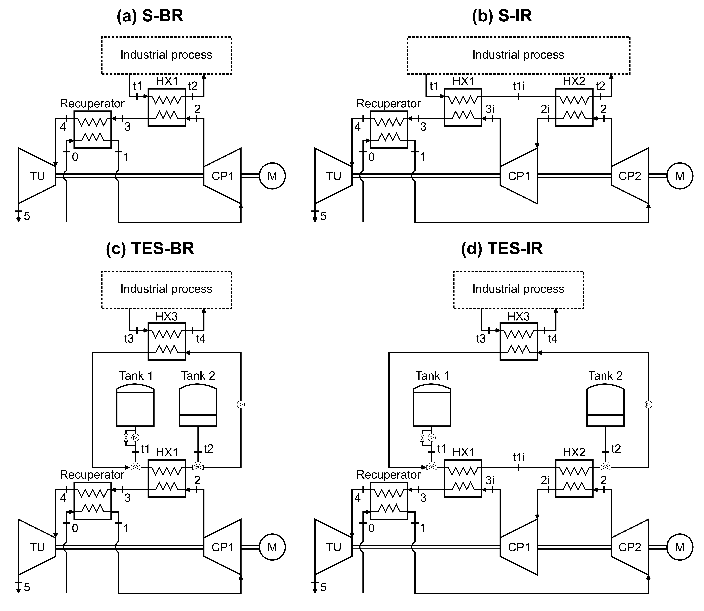

# Techno-economic assessment of thermal energy storage integrated reverse Brayton cycles for provision of high-temperature process heat

Simulation and post-processing repository accompanying the manuscript:

S. Grandin, A. Vecchi, A. Sciacovelli, "Techno-economic assessment of thermal energy storage integrated reverse Brayton cycles for provision of high-temperature process heat", [Journal]; [volume]:[pages], [year].
[doi.org/...](https://doi.org/)

## Table of Contents

* [Overview](#overview)
* [Directory Structure and Purpose](#directory-structure-and-purpose)
* [Repository Scope](#repository-scope)
* [Getting Started](#getting-started)
* [Citing this study](#citing-this-study)

## Overview

This repository provides the numerical models for the design, simulation and techno-economic assessment of recuperated air-based Brayton high-temperature heat pumps (HTHPs) with and without integrated sensible thermal energy storage (TES). The thermodynamic plants are modelled in [TESPy](https://tespy.readthedocs.io), the TES tanks use HITEC molten salt, and a mixed-integer optimization (Pyomo with the GLPK solver) schedules each plant against hourly day-ahead electricity prices. The resulting operation is turned into a levelized cost of heat (LCOH) using electricity price forecasts up to 2050.

Four plant layouts are assessed. They differ in whether TES is integrated and in whether the compression is intercooled. In every layout the cycle is recuperated.

| Label  | File-name prefix | Description                                        |
|--------|------------------|----------------------------------------------------|
| S-BR   | `S_BR_hthp`      | Standalone (no TES), base recuperated cycle        |
| S-IR   | `S_IR_hthp`      | Standalone (no TES), intercooled recuperated cycle |
| TES-BR | `TES_BR_hthp`    | TES-integrated, base recuperated cycle             |
| TES-IR | `TES_IR_hthp`    | TES-integrated, intercooled recuperated cycle      |



The models provided enable:

* design simulation of each layout, validated against the recuperated Brayton heat pump of Benvenuti et al.;
* performance, exergy and sizing results (tables, T-s and heat-exchanger diagrams);
* component cost estimation, including the TES tanks;
* optimization of the operational strategy over 2025 prices (DK1 and DE price zones, fixed and variable heat demand schedules);
* LCOH for the low, central and high price scenarios, and comparison across layouts and storage capacities.

The thermodynamic models are in `src/models`, the optimization in `src/plant_operation.py` and the economic analysis in `src/cost_analysis.py` and `src/lcoh_analysis.py`.

## Directory Structure and Purpose

* `data/` - Input data used to parameterise and validate simulations (validation reference, electricity prices and price scenarios).
* `docs/` - Repository design document and references.
* `examples/` - Minimal examples, e.g. comparison of layouts or execution of operational strategies.
* `main/` - Entry-point scripts that orchestrate the full techno-economic assessment workflow by calling the functions in `src/`.
* `results/` - Produced figures (PNG) and tables (CSV).
* `src/` - Source code: plant definition, models, TES tank sizing, exergy and cost analysis, operational optimization, LCOH analysis, plotting and tables.
* `tests/` - Space for reproducible validation and regression tests (currently empty).

Each top-level directory includes a dedicated README with folder-specific details.

## Repository Scope

This repository contains:

* Input data: validation reference and electricity prices (hourly 2025 and 2025-2050 scenarios).
* JSON definitions of components, connections and parameters of each layout.
* Python source code for the TESPy models, analysis and post-processing.
* Entry-point scripts and examples to reproduce the results of the companion manuscript.
* Generated plots (PNG) and tables (CSV) of the results.

## Getting Started

The typical workflow comprises 3 sequential steps:

1. Setting up the computational environment
2. Running the simulations
3. Inspecting the results

All models are set up to reproduce the investigated systems and associated results of the companion manuscript. The same code base allows the investigation of other layouts or conditions after suitable setup of the JSON input files in `src/input`.

### 1. Set up the computational environment

**Requirements**

* Python 3.12.2. The code was developed on Windows with Visual Studio Code.
* The Python packages listed in `requirements.txt` (TESPy, NumPy, matplotlib, pandas, CoolProp, fluprodia, Pyomo, highspy).
* Optional: the [GLPK](https://www.gnu.org/software/glpk/) solver (`glpsol`), installed on the system and reachable from the `PATH`. It is the solver used for the results of the paper. It is not a Python package, so `pip` does not install it. If it is not installed, the operational optimization uses the HiGHS solver (installed with `highspy`) instead.

**Create the Python environment**

It is recommended to use a dedicated Python virtual environment for this repository. This keeps the project's dependencies isolated from other Python projects installed on your computer.

From the root directory of the repository, create a virtual environment:

```bash
python -m venv tespy_env
```

Activate the virtual environment:

**Windows PowerShell:**

```powershell
.\tespy_env\Scripts\Activate.ps1
```

Once activated, the terminal should display `(tespy_env)` at the beginning of the command line.

**Install the required packages**

The Python packages required to run the code are listed in `requirements.txt`. With the virtual environment activated, install all of them by running:

```bash
python -m pip install -r requirements.txt
```

The `requirements.txt` file contains the external Python dependencies required by the repository. Python's standard-library modules, such as `os`, `json`, `pathlib`, and `re`, do not need to be installed separately. Whenever a new external package is required by the repository, it should be added to `requirements.txt`.

**Optimization solver**

The operational optimization is a mixed-integer linear problem, solved through Pyomo. The results of the paper were obtained with the [GLPK](https://www.gnu.org/software/glpk/) solver (`glpsol`), which is not a Python package: it has to be installed separately on the system and be reachable from the `PATH`. Check that it is found with:

```bash
glpsol --version
```

If GLPK is not installed, the HiGHS solver (`appsi_highs`) is used instead. It is installed together with the other packages by `requirements.txt` (package `highspy`), so no external installation is needed. The optimal operation can differ slightly between the two solvers when several solutions are equally good, so GLPK is recommended to reproduce the paper results exactly.

**Running in Visual Studio Code**

The scripts import from the `src` package (`from src import ...`) and write to paths relative to the repository root (for example `results/plots`). Two settings are therefore needed:

1. Open the repository root as the VS Code workspace folder, so that the scripts run with the repository root as working directory.
2. Select the virtual environment as interpreter: press `Ctrl+Shift+P`, choose "Python: Select Interpreter" and pick `tespy_env` (`.\tespy_env\Scripts\python.exe`).

### 2. Run the simulations

* **Full techno-economic assessment.** The scripts in `main/` run the complete workflow through `run_techno_economic_assessment`, which takes the layouts to simulate, the price zones, the heat demand schedules, the comparison figures to generate and the save path (`results/paper`). For each layout it:
  1. builds and solves the plant at the design point (`create_configured_network`, `build_into`, `solve`);
  2. validates the S-BR layout against the Benvenuti reference (`validate_plant`);
  3. generates the performance, sizing and connection tables, and the T-s and heat-exchanger diagrams;
  4. performs the exergy analysis (`get_exergy_analysis`);
  5. sizes the TES tanks for the TES layouts (`calculate_tanks_geometry`);
  6. estimates the component costs (`calculate_component_cost`);
  7. optimizes the operation over 2025 for each price zone and heat demand schedule (`optimize_operational_strategy`);
  8. calculates the LCOH for the low, central and high scenarios (`perform_lcoh_analysis`).

  Once all layouts are solved, the requested comparison plots are produced.
  * Inputs: layouts, price zones, heat demand schedules, comparison options; JSON files in `src/input`; price data in `data/`.
  * Outputs: tables and figures in `results/`.
  * Note: the default call reproduces the results of the manuscript. The inputs of the plants can be modified in the JSON files in `src/input` to test other conditions.
* **Examples.** The scripts in `examples/` run a single layout or a short comparison (e.g. the standalone layout against the TES-integrated one with different storage capacities) and are a good starting point to learn how the functions are used. They run the same way as the scripts in `main/`.

Run any script from the repository root with the environment activated, e.g.:

```bash
python examples/hthp_comparison.py
```

### 3. Inspect the results

All outputs are saved under `results/`: PNG figures and CSV tables, named with the layout prefix of the Overview (figures that compare layouts start with `all_hthp_`).

* `results/paper/`: tables and plots adopted in the paper.
* `results/plots/` and `results/tables/`: diagrams and tables per layout.
* `results/validation/`: comparison with the Benvenuti reference.
* `results/temporary/`: exploratory outputs of the examples.

All figures have a fixed paper width (3.34 in for one panel, 6.18 in for two panels). The style (fonts, colours, sizes) is defined in `src/input/styling/plot_style.json`.

It is recommended to read the folder-specific README files before running or modifying workflows for additional guidance. The repository design document in `docs/` describes the workflow and the options of `run_techno_economic_assessment` in detail.

## Citing this study
